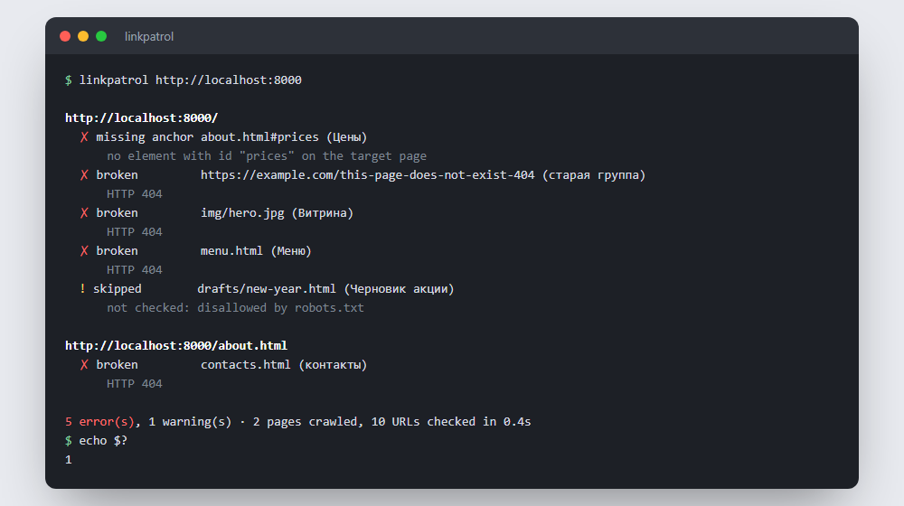

# linkpatrol: поиск битых ссылок на сайте

Консольная утилита на Go, которая обходит сайт и находит то, что ломается незаметно: ссылки на удалённые страницы, пропавшие картинки, якоря `#раздел`, которых нет на странице, цепочки редиректов и HTTP-ресурсы на HTTPS-странице. Один бинарник без зависимостей. Код выхода 1 при ошибках, поэтому удобно ставить в CI перед деплоем.




Это настоящий вывод на демо-сайте из [`examples/demo-site`](examples/demo-site), где ошибки заложены специально. Попробовать самому:

```bash
cd examples/demo-site && python -m http.server 8000
linkpatrol http://localhost:8000
```

## Что проверяет

| Проблема | Пример | Уровень |
|---|---|---|
| Битая ссылка или ресурс | страница отдаёт 404, домен не существует, таймаут | ошибка |
| Нет якоря | `about.html#prices`, а элемента с `id="prices"` на странице нет | ошибка |
| Смешанный контент | `<script src="http://…">` на HTTPS-странице | ошибка |
| Редирект | ссылка ведёт на `/old`, который перенаправляет на `/about` | предупреждение |
| Закрыто в robots.txt | страница не проверялась по правилам сайта | предупреждение |

- Проверяются `<a>`, ``, `<script>`, `<link rel=stylesheet>`, `<iframe>` и `<source>`. `mailto:`, `tel:`, `javascript:`, `data:` и подсказки вроде `preconnect` пропускаются.
- Хеш-маршруты одностраничных приложений (`#/cart`, `#!/cart`) не считаются якорями.
- `/index.html` и `/` считаются одной страницей, чтобы проблемы не дублировались.
- Учитывается `<base href>`.

## Установка

Бинарники для Linux, Windows и macOS лежат в [Releases](https://github.com/whysafe/linkpatrol/releases). Или из исходников:

```bash
go install github.com/whysafe/linkpatrol/cmd/linkpatrol@latest
```

## Использование

```bash
linkpatrol https://example.com                   # весь сайт, с внешними ссылками
linkpatrol example.com -depth 2 -c 16            # на два клика вглубь, 16 запросов параллельно
linkpatrol https://example.com -rps 5            # не чаще 5 запросов в секунду на хост
linkpatrol https://example.com -external=false   # только свой сайт
linkpatrol https://example.com -format json      # для скриптов
linkpatrol https://example.com -format markdown  # таблица для GitHub
linkpatrol https://example.com -strict           # код 1 и на предупреждениях
```

| Флаг | По умолчанию | |
|---|---|---|
| `-c` | 8 | параллельных запросов |
| `-depth` | -1 | глубина обхода в кликах от стартовой, -1 — весь сайт |
| `-max-pages` | 5000 | предохранитель для огромных сайтов |
| `-timeout` | 15s | на один запрос |
| `-external` | true | проверять ссылки на другие сайты |
| `-rps` | 0 | лимит запросов в секунду на хост, 0 — без лимита |
| `-format` | text | `text`, `json` или `markdown` |
| `-warnings` | true | показывать предупреждения |
| `-strict` | false | считать предупреждения ошибками |
| `-ignore-robots` | false | обходить и закрытые в robots.txt страницы |

Флаги можно писать и до, и после адреса. Коды выхода: `0` — всё в порядке, `1` — найдены ошибки, `2` — неверные аргументы или сайт не открывается.

### В GitHub Actions

```yaml
- name: Check links
  run: |
    go install github.com/whysafe/linkpatrol/cmd/linkpatrol@latest
    linkpatrol https://example.com -format markdown >> "$GITHUB_STEP_SUMMARY"
```

Отчёт появится таблицей на странице запуска, а шаг упадёт, если найдены ошибки.

## Как устроено

```
cmd/linkpatrol      флаги, коды выхода, вывод
internal/crawl      обход, разбор HTML, robots.txt, поиск проблем
internal/report     текст, JSON и Markdown
```

- **Обход:** пул воркеров и очередь задач. Каждый URL запрашивается один раз, дубликаты отсекаются при постановке в очередь. Внутренние HTML-страницы загружаются через GET и разбираются, всё остальное проверяется через HEAD. Если сервер не любит HEAD (405, 501, а некоторые отдают и 403/404), запрос повторяется через GET.
- **Глубина:** страницы глубже `-depth` не разбираются, но ссылки на них всё равно проверяются.
- **Редиректы:** цепочка записывается целиком, больше 10 переходов считается ошибкой. Конечная страница обходится под своим адресом и один раз, сколько бы старых адресов на неё ни вело.
- **Вежливость:** свой User-Agent, правила robots.txt (группа для своего агента или `*`, побеждает самое длинное правило, при равной длине Allow) и ограничение частоты запросов на хост.
- **Якоря:** для каждой разобранной страницы запоминаются все `id` и `<a name>`, и после обхода каждая ссылка с `#фрагментом` сверяется с ними.

**Ограничение:** JavaScript не выполняется. Если ссылки на сайте рисуются скриптом, linkpatrol увидит только те, что есть в исходном HTML.

## Тесты

```bash
go test -race ./...
```

Тесты поднимают поддельный сайт на `httptest` со всеми видами проблем и внешний сервер, который не принимает HEAD. Проверяется, что найдена каждая проблема и нет ложных срабатываний, работают ограничение глубины, отключение внешних ссылок, robots.txt и `-ignore-robots`, каждая страница скачивается один раз, работает лимит частоты. Отдельно покрыты разбор HTML (`<base>`, относительные пути, подписи ссылок), robots.txt и CLI: коды выхода, JSON, Markdown, флаги после адреса. В CI linkpatrol вдобавок проверяет демо-сайт и сверяет число найденных ошибок.

## Автор

whysafe · [whysafe.ru](https://whysafe.ru) · Telegram [@yawhysafe](https://t.me/yawhysafe) · канал [@whysafe_official](https://t.me/whysafe_official) · [Kwork](https://kwork.ru/user/whysafe) · hello@whysafe.ru

## Лицензия

MIT
